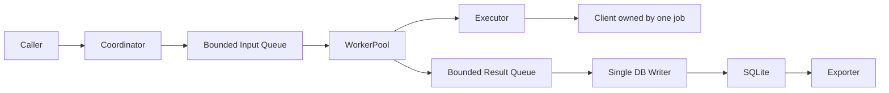

# Course_Day58：操作文件與架構說明

Phase 6（第 6 階段）｜約一小時｜[上一課](Course_Day57.md) · [教材索引](Course_Index.md) · [下一課](Course_Day59.md)

## 狀態與課前準備

- 這是預備教材，沒有替學員填寫上課結果。原有完成進度不變。
- 課前讀最近筆記；本課使用 Python 3.14 與專案虛擬環境。Day 1、Day 5 的範例需要已安裝 pytest 與 Paramiko，其餘範例以標準函式庫為主。
- 先觀念與範例、再三題複習、最後一道獨立練習；不一次貼完摘要就視為完成教學。
- 先備：已理解 Day 57 的契約；跨階段時先通過前一階段驗收。

## 本課用語

- Caller(呼叫端) 提供輸入與判斷預期；Executor(執行器) 執行工作並回報事實。
- SSH（Secure Shell，安全遠端連線協定）；Client(用戶端) 是負責通訊的物件。
- stdout（Standard Output，標準輸出）、stderr（Standard Error，標準錯誤）。
- CLI（Command-Line Interface，命令列介面）；CI（Continuous Integration，持續整合）。
- SQL（Structured Query Language，結構化查詢語言）；SQLite 是嵌入式關聯式資料庫。
- JSON（JavaScript Object Notation，JavaScript 物件表示法）；UTF-8（Unicode Transformation Format, 8-bit，八位元 Unicode 轉換格式）。
- API（Application Programming Interface，應用程式介面）；EOF（End Of File，輸入結束）。
- Worker Pool(工作者集區)、Queue(佇列)、Future(未來結果物件)、Repository(資料存取層)、Coordinator(協調者)。

## 今天要練習的項目

- [ ] 補齊安裝、範例、架構圖、測試分流、逾時、取消、重試與憑證限制。
- [ ] 逐段走查完整範例，說明資料與控制流程。
- [ ] 回答三題複習並接受回饋。
- [ ] 完成一道相似實作題的需求討論、實作與審查。

## 教學情境與需求

今天聚焦「文件契約」。在遠端測試框架中，本課要解決的需求是：補齊安裝、範例、架構圖、測試分流、逾時、取消、重試與憑證限制。

可觀察的驗收條件：依文件從乾淨環境完成最小操作；文件沒有私鑰、密語或依賴未說明的步驟。

先用下列獨立切片理解核心決策，確認理解後再依「整合步驟」改動正式專案。

## 實作重點與設計原因

- **1. 文件描述操作與可觀察行為，不只是列出類別名稱**
  - 說明：文件描述操作與可觀察行為，不只是列出類別名稱。
  - 走查：在下方範例中找出對應資料、分支或責任邊界，先口述預期行為，再執行確認。
- **2. 以乾淨環境走文件，找出隱藏前置條件**
  - 說明：以乾淨環境走文件，找出隱藏前置條件。
  - 走查：在下方範例中找出對應資料、分支或責任邊界，先口述預期行為，再執行確認。
- **3. 圖要呈現工作、連線與資料庫所有權，並寫出重試與取消限制**
  - 說明：圖要呈現工作、連線與資料庫所有權，並寫出重試與取消限制。
  - 走查：在下方範例中找出對應資料、分支或責任邊界，先口述預期行為，再執行確認。

### 為什麼採這個設計，而不是另一種做法？

文件以讀者完成任務為單位，而非依檔案順序抄程式；架構圖保留責任與資料流，避免列滿沒有意義的方框。

## 完整教學範例與執行方式

檔案：[CourseExamples/day58_documentation_acceptance_gate.py](CourseExamples/day58_documentation_acceptance_gate.py)。以下為完整內容：

```python
REQUIRED = {'installation', 'quickstart', 'configuration', 'architecture',
            'testing', 'timeouts', 'retry', 'cancellation', 'limitations'}

def missing_sections(sections):
    return REQUIRED - set(sections)

def test_document_gate():
    assert missing_sections(REQUIRED - {'limitations'}) == {'limitations'}
    assert not missing_sections(REQUIRED)

if __name__ == '__main__':
    test_document_gate()
    print('section presence is necessary, not sufficient; perform the documented steps')
```

在專案根目錄用 PowerShell 執行：

```powershell
.\.venv\Scripts\python.exe CourseNotes/CourseExamples/day58_documentation_acceptance_gate.py
.\.venv\Scripts\python.exe -m pytest CourseNotes/CourseExamples/day58_documentation_acceptance_gate.py -q
```

- 預期：程式正常結束，內含示範斷言通過；pytest 顯示該檔測試通過。效能課的秒數與記憶體數字隨環境變動，不提供固定期待值。
- 預設不連線、不要求密語、不修改既有測試與正式程式；資料庫與報告範例使用記憶體或暫存目錄。
- 本例只證明所示切片的行為。真實遠端、全面例外分類、硬性期限、整合取消與關閉等是否完成，依本課驗收另查，不由範例通過推定。

### 逐段走查順序

1. 列出函式／類別的輸入、回傳值、例外與誰擁有資源。
2. 從 test 函式的安排資料開始，追到被測函式，再回到 assert；解釋每個新增語法。
3. 對照上述三項設計重點；修改一個邊界輸入，先預測再驗證。
4. 區分範例已涵蓋與尚未涵蓋的契約，不將教學假物件當真實遠端證據。

## 整合回專案的步驟與限制

以 README 帶陌生讀者從安裝到假工作示範，再到選用 SSH；資源圖包含 Client per job 與單 writer。


### 架構示意與文件走查



文件必須說明：滿載時如何處理、指令總期限包含哪些階段、取消的限制、
送出後未知結果為何不盲目重跑、輸出保存上限、資料庫失敗如何回報。
這是目標架構圖；正式審查時刪改到與當時實作完全一致，不將圖視為已完成的系統。

## 本課測試與驗收

- [ ] 範例可執行，既有單元測試無回歸。
- [ ] 主題驗收：依文件從乾淨環境完成最小操作；文件沒有私鑰、密語或依賴未說明的步驟。
- [ ] 至少走查正常、失敗與邊界情境；設計課以完整情境表取代無關程式測試。
- [ ] 記錄每項證據的命令、實際結果與環境；沒執行就標「未驗證」。

## 三題複習

1. 操作文件應描述什麼？（對應實作重點第 1 項）
2. 為何需依文件從乾淨環境走一次？（對應實作重點第 2 項）
3. 架構圖需呈現哪些資源所有權？（對應實作重點第 3 項）

<details>
<summary>自我檢查方向：先作答，再展開</summary>

1. 文件描述操作與可觀察行為，不只是列出類別名稱。
2. 以乾淨環境走文件，找出隱藏前置條件。
3. 圖要呈現工作、連線與資料庫所有權，並寫出重試與取消限制。

</details>

<details>
<summary>一道相似實作練習：教學與三題複習完成後才展開</summary>

**題目：為陌生使用者寫最小操作指南。**

- 情境：將今天的核心設計套用到這個相似需求，不直接複製範例並改名稱。
- 驗收：能依步驟安裝與執行；秘密使用假值；架構圖與程式一致。
- 限制：先維持本課範圍；用假物件完成可重現案例，只有明確需要整合時才使用既有 Ubuntu。不得放入真實密語。
- 先討論：請學員列出輸入、輸出、責任、失敗與資源所有權；教師審查後才開始寫實作。
- 交付：一份小型實作或完整設計稿、對應驗收案例與結果；練習解答不預先提供。
- 建議位置：`Exercises/day58_practice.py`；設計／文件課使用同名 `.md`。如已有檔案，另選不覆蓋的位置。

</details>

## Code Review（程式碼審查）標準

- 本課首要檢查：文件描述操作與可觀察行為，不只是列出類別名稱。
- 失敗與邊界檢查：以乾淨環境走文件，找出隱藏前置條件。
- 契約與證據檢查：圖要呈現工作、連線與資料庫所有權，並寫出重試與取消限制。
- 主動檢查文件契約、狀態、資源所有權、責任邊界、輸入範圍、例外因果與清理、診斷資訊及測試有效性。
- 提出具體情境、影響、位置與改善方向；分成必須修正、非阻擋建議與後續延伸。不因未教功能否定當日成果。
- 測試全通過也要揭露仍存在的設計缺口；不為形式硬加抽象，評價需附驗證限制。

## 結課與筆記

- 當教學、三題複習、練習驗收與審查完成，才勾選 Day 58 並提醒當日課程結束。
- 新增 `Note_Day58_YYMMDD.md`；YYMMDD 使用台灣上課日期。跨日續課另建同 Day 的日期筆記，不修改教材名稱。
- 記錄實際較不熟悉的觀念、原先理解、釐清過程、仍待加強之處；不把一次答對視為完全熟練。
- 若超過約一小時仍未達標，記錄卡點，保留未完成狀態，下次續課。

## 官方參考資料

- [GitHub Python workflow](https://docs.github.com/en/actions/tutorials/build-and-test-code/python)
- [Python packaging](https://packaging.python.org/en/latest/tutorials/packaging-projects/)
- [pytest 使用與測試模式](https://docs.pytest.org/en/stable/example/simple.html)
